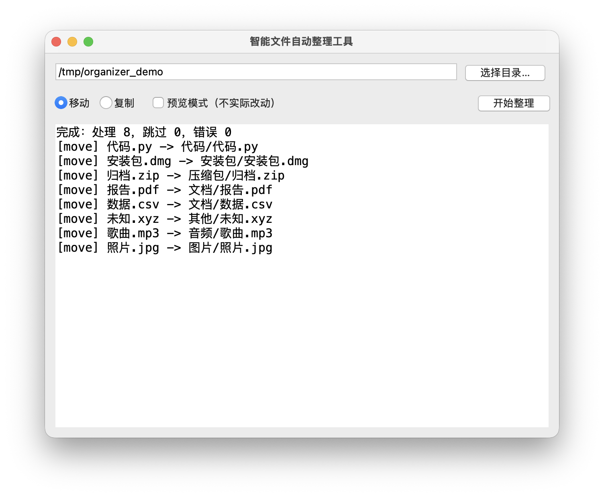

# 智能文件自动整理工具 (File Organizer)

零第三方依赖的桌面文件自动分类工具：一键把杂乱的下载目录按类别归档。
Python 标准库 + tkinter，`python app.py` 开箱即用。



## Features

- **60+ 扩展名分类规则**，9 大类别（图片/文档/压缩包/视频/音频/代码/安装包/字体/其他），支持自定义映射
- **移动 / 复制双模式** + **预览模式**（dry-run 先看计划再动手）
- **绝不覆盖**：同名冲突自动重命名 `file (1).ext`、`file (2).ext`…
- 不动子目录、不动隐藏文件；二次运行幂等
- **分层架构**：`file_organizer/core.py`（业务逻辑，零 GUI 依赖）与 `gui.py`（tkinter 薄壳）解耦，核心可独立测试/复用
- 附命令行版 `cli.py`，方便脚本化
- **12 个 pytest 测试**覆盖分类/冲突/双模式/dry-run/幂等/异常路径

## Quickstart

```bash
python app.py                      # GUI
python cli.py ~/Downloads --dry-run   # 命令行预览
python cli.py ~/Downloads --mode copy # 复制模式
pytest -q                          # 12 passed
```

## Architecture

```
app.py / cli.py          入口
└── file_organizer/
    ├── core.py          FileOrganizer：分类规则、冲突安全命名、organize()
    └── gui.py           tkinter 薄壳，后台线程执行，实时日志
```

核心保证（全部有测试背书）：

| 保证 | 实现 |
|---|---|
| 不覆盖用户数据 | `resolve_conflict()` 追加 (1)(2)… |
| 预览不动文件 | `dry_run=True` 只产出计划 |
| 不碰目录/隐藏文件 | 迭代时显式跳过 |
| 幂等 | 已归档文件位于类别目录内，二次运行全部跳过 |

## License

MIT
